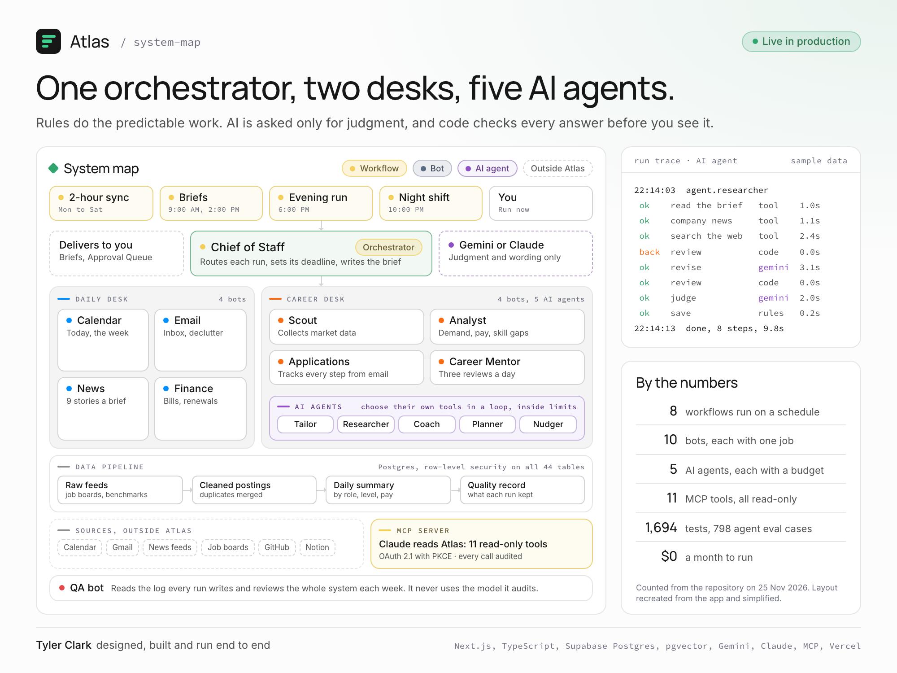
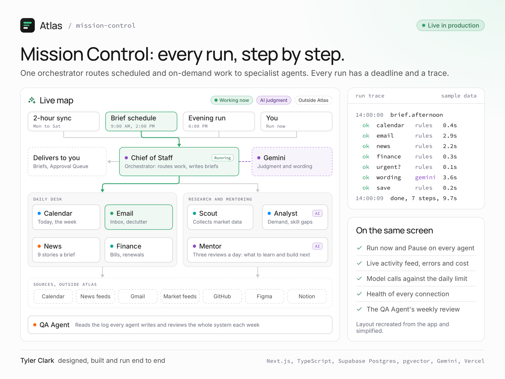
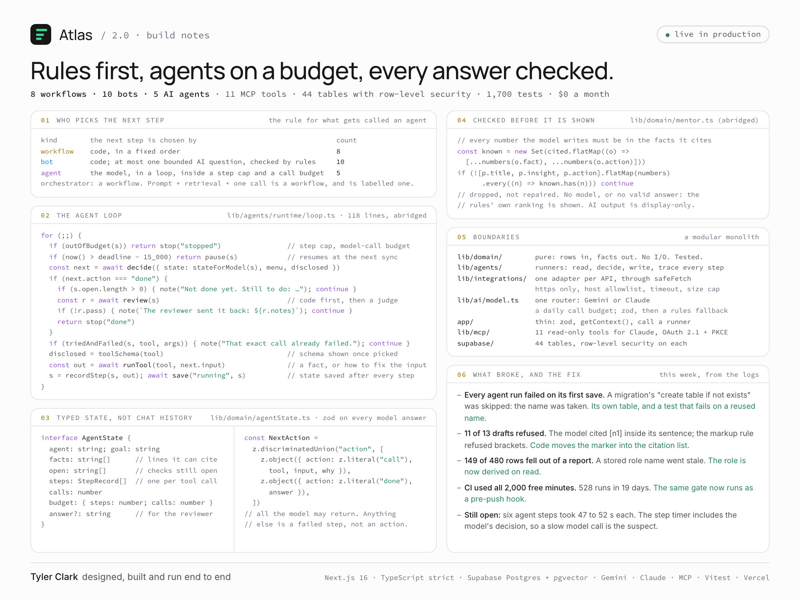
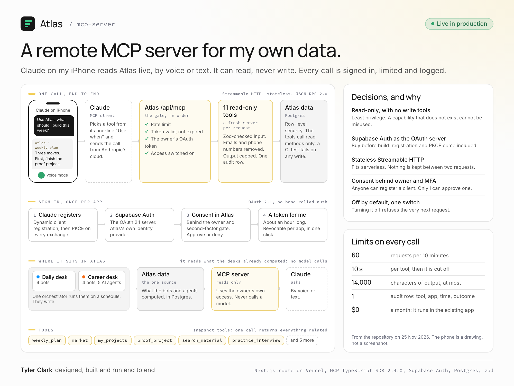
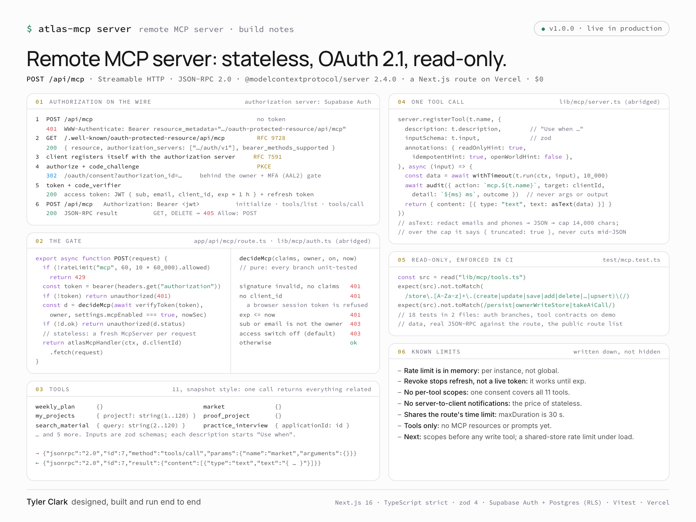
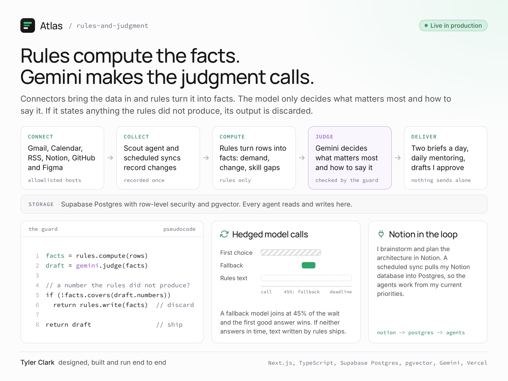
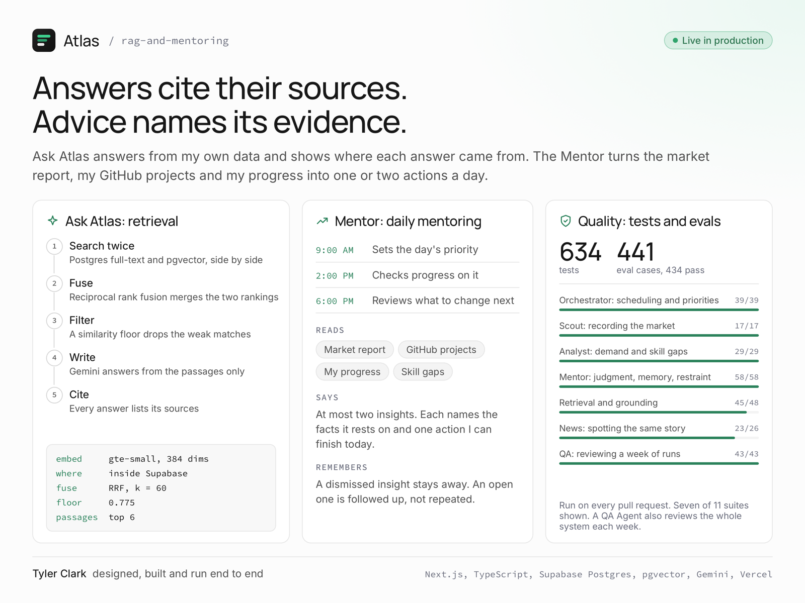

# Atlas

A multi-agent system I designed, built and run in production: a personal chief of staff, delivered as an installable web app.

An orchestrator directs specialist agents that read my calendar, inbox, news feeds and bills, write two briefs a day, answer questions from my own data with their sources, and mentor me daily. Agents draft, plan and recommend. Nothing leaves the app without my approval.

<picture>
  <source media="(prefers-color-scheme: dark)" srcset="docs/showcase/atlas-system-map-dark.png">
  
</picture>

**Status:** live in production for one owner. The deployment sits behind sign-in with two factors, so there is no public demo link. `npm run dev` starts a demo with fictional data and no keys.

## What changed since the first snapshot (refreshed 25 November 2026)

This public repo is a clean-history copy of the private repo, refreshed on 25 November 2026 (the first copy was from 18 November). The biggest changes since then:

- **Two desks, three kinds of worker.** A Daily desk (briefs, inbox, plan, Google Calendar, renewals, news) and a Career desk (live labor-market data, role targeting, a career map, a skills roadmap with proof projects). Atlas now names each worker by who picks the next step: 8 **workflows** (code, in a fixed order), 10 **bots** (code, with at most one bounded AI judgment) and 5 **AI agents** (the model picks its own next tool in a loop).
- **5 AI agents**, each a tool-using loop with a step cap, an AI-call budget, a rules review and a separate AI judge. Every tool is read-only.
  - **Researcher:** researches a company on the public web; every line cites a fact it read.
  - **Tailor:** maps each must-have in a posting to proof from my resume, or names it a gap.
  - **Coach:** prepares an interview with a true story for each likely question.
  - **Planner:** proposes three moves for my week, each citing its numbers; I approve before anything reaches my calendar.
  - **Nudger:** rewrites a waiting application follow-up with one specific, cited reason to reply.
  - A night shift runs the Researcher, Tailor and Nudger while I sleep, and the Planner on Sunday.
- **An MCP server for Claude:** Claude connects over OAuth 2.1 with PKCE and gets 11 read-only tools (apply queue, job snapshot, applications, funnel, market, proof project, interview prep, a spoken practice interview, weekly plan, my GitHub projects and search over my resumes and projects), so I can use Atlas from any Claude app, by voice. Every call is audited and rate-limited.
- **Google Calendar** over OAuth, with events at their real length on the plan.
- **By the numbers:** 1,630 tests, 44 tables with row-level security, 48 migrations and 200+ merged pull requests.

## What I built

| Area | What it does | Where to look |
| --- | --- | --- |
| Agent orchestration | One orchestrator (the Chief of Staff) routes scheduled and on-demand work to eight specialists and a QA agent. Each has one job and a written list of what it never does. Every run has a deadline and a step-by-step trace. | [`lib/agents/`](lib/agents), [`agents/`](agents), [docs/ARCHITECTURE.md](docs/ARCHITECTURE.md) |
| Rules plus AI judgment | Rules compute every fact. The model only decides what matters most and how to say it, and its output is discarded if it states anything the rules did not produce. | [`lib/domain/`](lib/domain), [`lib/ai/`](lib/ai) |
| Reliable model calls | One router in front of Gemini and Claude. Calls are hedged with a fallback model, bounded by the run's deadline, and every AI feature has a rules-only path. | [`lib/ai/model.ts`](lib/ai/model.ts), [`lib/ai/gemini.ts`](lib/ai/gemini.ts) |
| Connectors | Gmail, calendar (iCal), RSS, Notion, GitHub and Figma through one fetch layer: HTTPS only, allowlisted hosts, timeouts and size caps. Stored tokens are sealed with AES-256-GCM. | [`lib/integrations/`](lib/integrations), [`lib/security/`](lib/security), [docs/INTEGRATIONS.md](docs/INTEGRATIONS.md) |
| Retrieval (Ask Atlas) | Hybrid search over Postgres full-text and pgvector, reciprocal rank fusion, a similarity floor set from an eval, and answers that cite their sources. | [`lib/knowledge/`](lib/knowledge), [docs/RAG.md](docs/RAG.md) |
| Mentor | Three reviews a day. Each insight names the facts it rests on and one action for today, and the agent remembers what was dismissed. | [`lib/agents/mentor.ts`](lib/agents/mentor.ts), [docs/CAREER-DESK.md](docs/CAREER-DESK.md) |
| Mission Control | A live map of the orchestration drawn from the agents' own activity log, with run traces, Run now and Pause, connection health and the weekly QA review. | [`lib/domain/orchestration.ts`](lib/domain/orchestration.ts) |
| Human in the loop | Agents draft; I approve and send from my own apps. An outbound kill switch and an append-only audit trail back that up. | [docs/SECURITY.md](docs/SECURITY.md) |
| Evals and tests | 1,630 tests and 490 labeled eval cases across 11 suites on every pull request, each suite with a bar it must clear. | [`lib/evals/`](lib/evals), [`test/`](test), [docs/EVALS.md](docs/EVALS.md) |
| Security | Mapped to NIST CSF 2.0: single-owner sign-in with TOTP enforced in the database, row-level security, a nonce-based CSP, a threat model and a written security review. | [docs/NIST-CSF.md](docs/NIST-CSF.md), [docs/THREAT-MODEL.md](docs/THREAT-MODEL.md), [docs/SECURITY-REVIEW.md](docs/SECURITY-REVIEW.md) |

Estimated time saved: about 10 hours a week across the daily automations. The per-automation estimates are in [`lib/domain/playbook.ts`](lib/domain/playbook.ts).

## How it works

### Mission Control



One orchestrator routes scheduled (Vercel cron) and on-demand work to the specialists. Every run has a deadline, 60 seconds on a page and 300 on a schedule, and every step is traced: which agent, rules or model, and how long it took. Mission Control draws its live map from that activity log, so there is no separate telemetry to maintain. A QA agent reads the same log and reviews the whole system once a week.

### The agent loop

<picture>
  <source media="(prefers-color-scheme: dark)" srcset="docs/showcase/atlas-2-technical.png">
  
</picture>

Five AI agents run on one loop of 118 lines. Each cycle the model returns one action, a tool call or "done", that must match a zod schema. "Done" is refused while checks are open, a reviewer runs before anything is accepted (code first, then a judge model), and the state is saved after every step. Each run has a step cap and a model-call budget.

### The MCP server

<picture>
  <source media="(prefers-color-scheme: dark)" srcset="docs/showcase/atlas-mcp-server-dark.png">
  
</picture>

Claude reads Atlas through a remote MCP server: 11 read-only tools behind OAuth 2.1 with PKCE, a stateless endpoint, and an audit row for every call. A test fails the build if a tool ever writes. How it was built, and every decision: [docs/MCP-BUILD.md](docs/MCP-BUILD.md).

<picture>
  <source media="(prefers-color-scheme: dark)" srcset="docs/showcase/atlas-mcp-server-technical.png">
  
</picture>

### Rules compute the facts, the model makes the judgment calls



Connectors bring the data in and plain TypeScript turns it into facts. The model words a brief or picks what matters most, then a guard checks its text against those facts: a number the rules did not produce means the text is thrown away and the rules-written version ships. Model calls are hedged. The first-choice model gets a head start, a faster fallback joins at 45% of the wait, and the first good answer wins.

### Retrieval, mentoring and quality



Ask Atlas searches twice (Postgres full-text and pgvector), fuses the two rankings, drops weak matches under a similarity floor of 0.775 and passes the top six passages to the model, which answers from those passages only and lists its sources. Embeddings (`gte-small`, 384 dimensions) are generated inside Supabase, so indexing sends no text to an outside service. [docs/RAG.md](docs/RAG.md) has the eval that set the floor.

The images are simplified: they use sample data and do not show every agent. Numbers are from 17 November 2026.

## Engineering practice

- Every change ships through a pull request. Lint, type check, tests, agent evals, a dependency audit, a build and a secret scan must pass, and GitHub Actions are pinned to commit SHAs.
- `lib/domain` is pure logic with no I/O and imports nothing outside itself, which is why it has the densest tests.
- zod validates every boundary: server actions, model output and integration responses.
- An eval suite that drops below its bar fails the build. Known gaps are printed on every run, not hidden.
- Secrets live in the host's encrypted settings, never in the repository.

## Stack

Next.js 16 (App Router, server components, server actions), React 19, TypeScript strict, Tailwind CSS 4, Supabase Postgres and Auth with row-level security, pgvector with `gte-small` embeddings (Supabase Edge Function), Gemini or Claude behind one model router, zod, Vitest, Vercel (hosting and cron), GitHub Actions.

- [docs/ARCHITECTURE.md](docs/ARCHITECTURE.md): layers, data flow, the agent model, why the planner is not an LLM.
- [docs/SECURITY.md](docs/SECURITY.md): controls, secrets, the kill switch, incident response and recovery.
- [docs/NIST-CSF.md](docs/NIST-CSF.md): every NIST CSF 2.0 function mapped to the code that implements it.
- [docs/THREAT-MODEL.md](docs/THREAT-MODEL.md): assets, trust boundaries, threats and mitigations.
- [docs/EVALS.md](docs/EVALS.md): the eval suites, what each one scores and the bar it must clear.
- [docs/RAG.md](docs/RAG.md): Ask Atlas: what is indexed, hybrid retrieval, grounded answers, and its security review.
- [docs/CAREER-DESK.md](docs/CAREER-DESK.md): the Career desk: Scout, Analyst, Applications and Mentor, how they hand off, and how the Mentor is kept honest.
- [docs/INTEGRATIONS.md](docs/INTEGRATIONS.md): Gmail, push, Siri capture, the morning job, applications from email, feeds, boards, calendar.
- [docs/MCP-CAREER-GUIDE.md](docs/MCP-CAREER-GUIDE.md): the MCP build for job prep: why it is the best way, the stack to showcase, resume lines, the skills to direct it, and the decisions that would make it elite.
- [docs/MCP-BUILD.md](docs/MCP-BUILD.md): how the MCP server was built, step by step, with the decision log, the security model and how to explain it.
- [docs/CLAUDE-CONNECTOR.md](docs/CLAUDE-CONNECTOR.md): talk with Claude about the job search (voice included) through Atlas's read-only MCP connector; why the official `@modelcontextprotocol/server` SDK was chosen and Vercel's `mcp-handler` wrapper was not (it adds OpenTelemetry packages Atlas does not need).
- [docs/PROGRESS.md](docs/PROGRESS.md): the build log, one dated entry per session.

## Every screen

<details>
<summary>The tabs, what each one gives you, and the agent behind it</summary>

Four main tabs, left to right: **Today**, **Growth**, **Career**, **People**. Everything else is below them in the sidebar, and under More on a phone.

| Tab | What you get | Agent |
| --- | --- | --- |
| **Today** | The 9:00 AM and 2:00 PM briefs (a lighter one on Saturday, none on Sunday): the Hot List first, then calendar and week ahead, email, 9 stories, bills and the job search. Below: now / next, today's top three, people to reach, routines, time saved | Chief of Staff |
| **Growth** | **Daily mentoring** first: your Mentor's three reviews of the day (morning priority, midday check, evening review), each insight with the facts it rests on and Done / Not useful. Then the Analyst's market report for your roles, your skill gaps, your GitHub projects, and your LinkedIn text for review | Mentor, Analyst |
| **Career** | The job hunt, start to finish. **Good fits** first: a 👍 sends a job to the **Apply Queue** (open it on your MacBook, apply on their site with Atlas Autofill, mark submitted); follow-ups to send wait there too. Save a job from LinkedIn, Indeed or Glassdoor by pasting it. Inside it: Target roles, Applications and the Job watchlist | Applications |
| **People** | Keeping in touch by text. **Share a thought or idea**: write it once, pick who gets it, and each person gets their own draft in your words. Keep-in-touch cadences and birthdays, a composer that drafts texts and emails (the AI model or an offline drafter) and hands them to Messages / Mail, contacts by circle. Atlas never sends: you do | Email |
| **Inbox** | Gmail sorted by rules into Needs a reply, FYI and Noise, tagged Job, Finance, Subscription or Store; one-click Archive, your tracked subscriptions' latest updates, and a declutter list you approve. Headers only, except job emails and emails from companies you applied to: the Applications bot reads their text by rules for the kind of answer it is (a rejection, an interview invite, an assessment, a request, an offer) or the role, and shows the sentence that decided it. No email text goes to an AI model unless you turn the model reader on in Settings (off by default; docs/SECURITY.md) | Email |
| **Ask Atlas** | Ask a question in plain words and get an answer from your own data with its sources: hybrid search (Postgres full-text + pgvector embeddings, fused), then Claude writes from the retrieved passages only, or the closest passages are shown when AI is off | Chief of Staff |
| **Plan** | Monday–Sunday load bars, a board grouped Overdue / Today / each day / Later / Backlog with status and priority pills, one-tap auto-planner, weekly goals, Sunday review | – |
| **Projects** | Side projects, ideas and things to learn, each with a next step and a review date. Active ones and those due for a look come back in the brief | Chief of Staff |
| **News** | AI, tech, U.S. politics and world news from the plan's sources (center and conservative), interleaved by source, with a 2-minute Claude digest | News |
| **Renewals** | Bills, registrations and documents. A heads-up inside the lead window, https links only, and monthly or yearly dates that roll forward when you mark them handled | Finance |
| **Your team** | The Chief of Staff, eight specialists, four of them the Career desk (Scout, Analyst, Applications, Mentor), and the QA bot that reviews them all, each with what it owns and never does, and minutes saved | – |
| **Applications** | The application tracker as a board (To submit, Applied, Replied, Interview, Offer, Rejected) with filters by type, role and date, applications logged automatically from your "thank you for applying" emails (plus a one-time Gmail catch-up), CSV export, and saved searches for sites with no public feed. **Heard back**: every answer from a company (a reply, an invite, an assessment, an offer, a rejection) in one feed with an unread count, and one push to your phone that opens that application, held between 9 PM and 7 AM | Career |
| **Mission Control** | Laid out for an iPad or laptop, and readable on a phone (under More), where each agent is one row you tap open: every agent's status with Run Now and Pause, the live activity feed, errors, cost today, connection health, the job pipeline and searchable brief history. An **AI judgment** card shows the model, its fallback, today's calls against the daily limit, and how each AI agent's last run went. A **Live map** toggle shows the orchestration lit up as agents work: the Daily and Career desks, the AI model and the four agents it judges for, and the sources outside Atlas. Select any box for what it reads, judges and writes; replay the last run; display mode for an iPad or second monitor A **QA review** card holds the QA bot's weekly review of Atlas itself: ranked findings with evidence and a suggested fix, what got fixed since last week, and every check it ran | Chief of Staff |
| **Connectors** | Gmail, the morning push to your iPhone, Siri capture, calendar, Claude, feeds and boards: what is connected and what each one can do | – |
| **Settings** | Preferences, the outbound kill switch, integration health, the append-only audit trail, full data export, sign out everywhere | – |

</details>

## Run it

```bash
npm install
npm run dev
```

Open http://localhost:3000. With no Supabase settings it runs in **demo mode**: fictional data in memory, no sign-in, and a banner that says so. Weather, news and job boards are live public sources.

```bash
npm run check   # lint + typecheck + unit tests
npm run build
```

To go live (Supabase, Google sign-in, MFA, Vercel), follow [docs/DEPLOY.md](docs/DEPLOY.md). To install on iPhone or iPad: open the site in Safari, Share, **Add to Home Screen**. Once installed, turn on the morning notification in Connectors.

Every morning around 6 AM a scheduled job syncs your inbox, builds the brief and pushes its first lines to your phone. "Hey Siri, add to Atlas" drops a thought into your backlog from anywhere.

## Principles

1. **Draft, don't act.** AI output is displayed, never executed. Sending happens in your own apps.
2. **Facts from data, prose from AI.** The brief and the plan are computed by tested rules; the model may only reword them. Ask Atlas answers only from passages it retrieved, and shows them.
3. **Works with no keys.** Every AI feature has an offline path. Every feed fails on its own.
4. **One owner, two factors.** Single-account sign-up, TOTP required, enforced in the database.
5. **Small blast radius.** Fixed outbound allowlist, read-only integrations, a kill switch, an append-only audit trail.

Built by [Tyler Clark](https://github.com/saltylvn).
